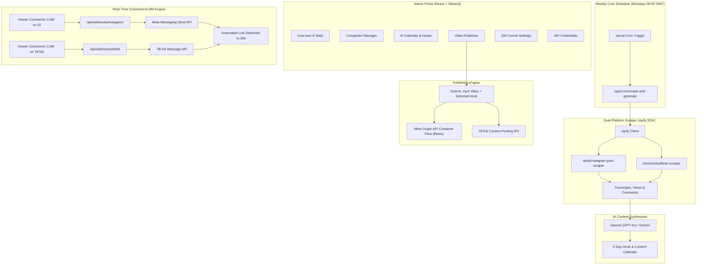

# ViralPulse AI — Autonomous Instagram & TikTok SaaS Engine

ViralPulse AI is a production-ready, full-stack Next.js application designed for autonomous short-form video operations across Instagram and TikTok.

It combines:
1. **Admin Portal (Frontend)**: Real-time React dashboard for managing target competitors, reviewing weekly AI content calendars, routing video uploads, setting up DM automation funnels, and managing credentials.
2. **Dual-Platform Scraper (Apify Layer)**: Serverless endpoint (`/api/cron/scrape-and-generate`) triggered weekly by Vercel Cron. It runs Apify's `apify/instagram-post-scraper` and `clockworks/tiktok-scraper` to pull transcripts, video view velocity, and audience comments.
3. **AI Intelligence Layer**: LLM synthesis engine (OpenAI GPT-4o / Google Gemini 1.5 Pro) that extracts viral retention patterns, confrontational hooks, and curiosity gaps, generating a 5-day content calendar.
4. **Publishing Layer**: Multi-platform video deployment routing `.mp4` video files to Instagram Reels (via Meta Graph API's 3-step Container flow) and TikTok (via TikTok Content Posting API).
5. **Real-Time DM Automation**: Webhook listeners (`/api/webhooks/instagram` and `/api/webhooks/tiktok`) that intercept comments containing your trigger keyword (e.g. `LINK`) and immediately DM the viewer your link.

---

## Architecture Diagram



---

## Project Structure

```
├── app/
│   ├── api/
│   │   ├── calendar/route.ts                # Calendar concepts CRUD
│   │   ├── competitors/route.ts             # Target accounts CRUD
│   │   ├── cron/scrape-and-generate/route.ts# Vercel Cron scraper & AI engine
│   │   ├── logs/route.ts                    # DM & publishing activity logs
│   │   ├── publish/instagram/route.ts       # Meta Graph API Reels publisher
│   │   ├── publish/tiktok/route.ts          # TikTok Content Posting API publisher
│   │   ├── settings/route.ts                # API credentials manager
│   │   ├── webhooks/instagram/route.ts      # Instagram comment listener & DM dispatcher
│   │   └── webhooks/tiktok/route.ts         # TikTok comment listener & DM dispatcher
│   ├── globals.css                          # Tailwind CSS styling
│   ├── layout.tsx                           # Root app layout
│   └── page.tsx                             # Master Admin Portal
├── components/
│   ├── CompetitorScraperView.tsx            # Competitor accounts manager & manual trigger
│   ├── ContentCalendarView.tsx              # 5-day AI calendar with 1-click hook copy
│   ├── DashboardOverview.tsx                # Metric cards & live activity stream
│   ├── DmAutomationView.tsx                 # Keyword triggers & webhook helpers
│   ├── PublisherView.tsx                    # Video uploader & multi-platform publisher
│   ├── SettingsView.tsx                     # API keys & webhook secret manager
│   └── Sidebar.tsx                          # App navigation & Cron health indicator
├── lib/
│   ├── ai.ts                                # OpenAI & Gemini short-form hook generator
│   ├── apify.ts                             # Apify client wrapper for IG & TikTok
│   ├── meta.ts                              # Meta Graph API Reels & DM client
│   ├── store.ts                             # Local file & serverless memory store
│   ├── tiktok.ts                            # TikTok Content Posting API client
│   └── types.ts                             # Strong TypeScript interfaces
├── .env.example                             # Environment variable template
├── next.config.mjs                          # Next.js configuration
├── package.json                             # Dependencies
├── tailwind.config.ts                       # Tailwind styling configuration
├── tsconfig.json                            # TypeScript configuration
└── vercel.json                              # Vercel Cron definitions
```

---

## Quickstart (Local Development)

### 1. Install Dependencies
```bash
npm install
```

### 2. Configure Local Environment
Copy `.env.example` to `.env`:
```bash
cp .env.example .env
```
Fill in your credentials (or enter them directly through the graphical **API Credentials** portal in the dashboard).

### 3. Run the Development Server
```bash
npm run dev
```
Open [http://localhost:3000](http://localhost:3000) in your browser.

---

## Vercel Deployment

1. Push your repository to GitHub:
   ```bash
   git init
   git add .
   git commit -m "feat: initial ViralPulse SaaS commit"
   git branch -M main
   git remote add origin https://github.com/your-username/viralpulse-saas.git
   git push -u origin main
   ```
2. Import the project in the [Vercel Dashboard](https://vercel.com/new).
3. Under **Environment Variables**, add:
   - `CRON_SECRET`: Any random 32-character string (used to authenticate Vercel Cron calls).
   - `APIFY_TOKEN`: Your Apify personal API token.
   - `AI_PROVIDER`: `openai` or `gemini`.
   - `OPENAI_API_KEY` or `GEMINI_API_KEY`.
   - `META_ACCESS_TOKEN`: Your Meta Graph API Long-Lived Token.
   - `INSTAGRAM_ACCOUNT_ID`: Your Instagram Professional/Business Account ID.
   - `META_WEBHOOK_VERIFY_TOKEN`: A custom string of your choice (e.g. `viralsaas_meta_verify_token`).
   - `NEXT_PUBLIC_APP_URL`: Your production Vercel URL (e.g. `https://viralpulse.vercel.app`).
4. Click **Deploy**. Vercel will automatically detect `vercel.json` and schedule the `/api/cron/scrape-and-generate` cron job for every Monday at 09:00 UTC.

---

## Meta Developer App Setup (Instagram)

To enable automatic Reels publishing and real-time comment-to-DM triggers:

### Step 1: Create a Meta Developer App
1. Go to [developers.facebook.com](https://developers.facebook.com/) and click **Create App**.
2. Select **Other** > **Business** as the app type.
3. In the App Dashboard, add the **Instagram Graph API** and **Webhooks** products.

### Step 2: Connect Instagram Business Account
1. Ensure your Instagram account is switched to a **Business** or **Creator** account.
2. Link your Instagram account to a Facebook Page in Meta Business Suite.
3. Obtain your `INSTAGRAM_ACCOUNT_ID` by querying:
   ```bash
   curl "https://graph.facebook.com/v21.0/me/accounts?access_token=YOUR_PAGE_TOKEN"
   ```

### Step 3: Generate a 60-Day Long-Lived Access Token
1. In the **Graph API Explorer**, select your app.
2. Add the following permissions:
   - `instagram_basic`
   - `instagram_content_publish`
   - `instagram_manage_comments`
   - `instagram_manage_messages`
   - `pages_read_engagement`
   - `pages_show_list`
3. Generate a user access token, then exchange it for a long-lived access token:
   ```bash
   curl -X GET "https://graph.facebook.com/v21.0/oauth/access_token?\
     grant_type=fb_exchange_token&\
     client_id=YOUR_META_APP_ID&\
     client_secret=YOUR_META_APP_SECRET&\
     fb_exchange_token=SHORT_LIVED_TOKEN"
   ```

### Step 4: Configure Webhooks
1. In Meta Developer Portal, go to **Webhooks** > select **Instagram**.
2. Click **Subscribe to this object**.
3. **Callback URL**: `https://your-domain.vercel.app/api/webhooks/instagram`
4. **Verify Token**: Must match `META_WEBHOOK_VERIFY_TOKEN` (default: `viralsaas_meta_verify_token`).
5. Under Subscriptions, subscribe to the **`comments`** field.

---

## TikTok Developer App Setup

### Step 1: Register on TikTok for Developers
1. Register at [developers.tiktok.com](https://developers.tiktok.com/).
2. Create an App and apply for the **Content Posting API**.
3. Under App Scopes, request:
   - `video.publish`
   - `video.upload`
   - `user.info.basic`

### Step 2: Configure Webhook
1. In the TikTok Developer portal, navigate to **Webhooks**.
2. Set the Callback URL to: `https://your-domain.vercel.app/api/webhooks/tiktok`.
3. Set the verify token to match your `TIKTOK_WEBHOOK_VERIFY_TOKEN`.
4. Subscribe to the `comment` event.

---

## Workflow Details

### 1. Dual-Platform Competitor Scraping & AI Hook Generation
- Target accounts (e.g. `@danmartell`, `@hertz_fauzan`) are monitored.
- Every Monday at 09:00 UTC (or manually via the dashboard), the Apify SDK fetches their latest 5 posts/videos.
- Transcripts and top audience comments are fed into GPT-4o / Gemini 1.5 Pro.
- The AI identifies high-performing psychological triggers (e.g. confrontational questions, contrast dualities, hard truths) and outputs a structured 5-day calendar with opening 2-second hooks, body outlines, and call-to-actions.

### 2. Multi-Platform Video Publishing
- Users select a generated concept or input a hook, then provide an `.mp4` video URL (hosted on Google Drive, AWS S3, Cloudinary, or Vercel Blob).
- **Instagram Reels**: Executes Meta's container flow (`POST /{ig_id}/media` -> poll status until `FINISHED` -> `POST /{ig_id}/media_publish`).
- **TikTok**: Calls `POST /v2/post/publish/video/init/` using `PULL_FROM_URL`.

### 3. Comment-to-DM Funnel
- When a viewer comments your designated trigger word (e.g. `LINK`), Meta sends a webhook notification to `/api/webhooks/instagram`.
- The webhook verifies the comment text, constructs the personalized message with your destination URL, and calls Meta's Send API to deliver the private message to the commenter.
- All delivery events are displayed in real-time in the Admin Portal under **DM Automation**.

---

## License
MIT
